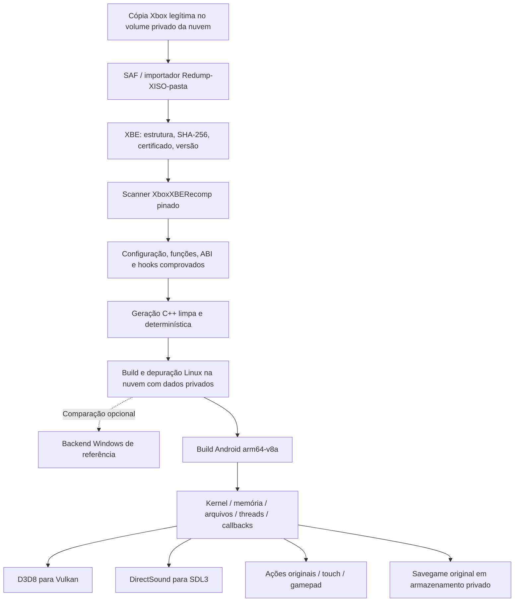

# Arquitetura — Urban Chaos Android Recomp

Atualização 0.6: consultas de visibilidade têm submissão/polling separados da espera de idle. Pools giram por submissão, enquanto o relógio de apresentações continua ligado ao Present real. Fences e acesso a recursos respeitam comandos guest anteriores; texturas observam escritas também dentro do mesmo frame. [Rotas e limites](MISSION_RENDERER_06.md).

Atualização 0.5: tradução e cache de carregamento são opções independentes e reversíveis. O cache recodifica apenas a compressão do contêiner, preservando cada recurso descomprimido, e deixa a ISO intacta. A missão no tablet continua em investigação; medições Linux não qualificam desempenho Android. [Experimento, diagnóstico e limites](LOADING_05_INVESTIGATION.md).

Atualização 0.4: o proprietário entrou na missão no tablet com 0.3, mas relatou lentidão/defeitos. O HUD de navegação passa a usar analógico; o jogo já oferece sensibilidade dentro de Options → Controller. Tradução parcial utiliza bancos nativos e substituições imutáveis no disco, sem modificar a ISO. [Contrato e limites](NATIVE_SUBTITLES.md).

Na versão 0.3, a Activity usa overlay touch de tela inteira, fontes Xbox com preservação de taps e descoberta de conexão separada da leitura guest; o Vulkan oferece ajustar/preencher/esticar. O layout é privado e separado dos saves. Essas mudanças não alteram a lógica do título nem qualificam o loading da missão. [Contrato e validação](TOUCH_HUD.md).

Atualização após o primeiro teste Android: o APK inicia no Pad 6, com desempenho baixo, áudio entrecortado e missão presa em loading. O novo build otimiza guest/host e acrescenta telemetria; ainda requer novo teste. [Evidência e limites atuais](TABLET_LOADING_INVESTIGATION.md). As qualificações Linux e os relatos de ausência de teste a seguir são históricos.

**Objetivo:** launcher Android baseado na ISO Xbox original, com núcleo ARM64 recompilado, preservando lógica, missões, IA, física, gráficos, áudio e progressão. Prioridade: Xiaomi Pad 6 com HyperOS 2.0.16.0. **Estado atual: geração determinística e código compilado; host Linux apresenta menus e a abertura de Hope Street também em Vulkan. Biblioteca ARM64 e APK experimental privados construídos; gameplay, áudio audível, boot Android e qualificação completa pendentes. [Evidências](RUNTIME_PROGRESS.md).**

A experiência final de seleção da ISO, reconhecimento e início do jogo está definida em [LAUNCHER_DESIGN.md](LAUNCHER_DESIGN.md). O diagrama abaixo descreve a construção do núcleo; o tablet não executa essa recompilação ao importar a imagem.

A API compartilhada `native/game/source.*` faz reconhecimento, validação e ativação da montagem antes do boot. O host Linux já a utiliza; o contrato compila para Android AArch64. A seleção SAF ainda deve chamar essa API após concluir staging, sem publicar uma instalação incompleta. Ver [testes e limites](LAUNCHER_DESIGN.md#ligação-executável-da-fonte-do-jogo).

## Construção do núcleo na nuvem

Windows não é entrada nem requisito do build Android: o mesmo C++ gerado é compilado para cada arquitetura com seu host. O host Linux serve para depurar HLE/ABI e estado do dispositivo; Windows fica como comparação opcional. [Investigação executada](AUDIO_INVESTIGATION.md).

Importação de assets e recompilação são etapas distintas. O APK final deverá ser compilado contra uma versão de executável qualificada; importar outro XBE não o torna automaticamente compatível. O código gerado deriva do executável comercial: precisa de revisão de direitos antes de qualquer distribuição, mesmo que não contenha a ISO. Não publicar esse código ou incluí-lo indiscriminadamente em artefatos CI.

## Camadas e proveniência

| Camada | Base e decisão | Estado |
|---|---|---|
| Conteúdo/lógica do título | Executável Xbox e seus assets do usuário; nenhum substituto simplificado | XBE extraído; recursos solicitados disponíveis privadamente |
| Geração estática | XboxXBERecomp `c1f7d60...` com Zydis e toml++ | 29.049 funções geradas duas vezes com saídas idênticas; código compila em x86_64 |
| Integração Urban Chaos | Consumidores, hooks e patches públicos da Burner; não transplantar Black | Auditados por leitura; licença das adaptações precisa ser esclarecida |
| Runtime portátil | Contratos CPU/kernel/HLE do SDK; pin Burner | Contrato CPU AArch64 compila; runtime completo do título não demonstrado |
| Host Android | Infraestrutura MIT do Black como referência: lifecycle, Vulkan, áudio, entrada; revisão por arquivo antes de incorporação | Interfaces e exclusões identificadas; nenhum hook Black importado |
| Disco | XDVDFS próprio limitado; XboxKit como referência externa de Redump | Imagem fornecida inspecionada; XBE e recursos parciais extraídos/verificados; ISO inteira não validada |
| HUD | Ações Urban Chaos verificadas, ícones originais, perfis e multitouch | Especificação; mapeamento binário pendente |

`android/` contém o diagnóstico da etapa anterior, preservado como histórico. Ele não é o módulo do jogo, não contém lógica original e não será ampliado para aparentar gameplay. A CI pública compila contratos de portabilidade, renderer/host Android com perfil autoral e Java/SDL contra SDK34, sem código comercial. O APK real foi construído privadamente com o arquivo guest e sua [receita](ANDROID_BUILD.md).

## Contratos obrigatórios

Endianness little-endian, endereços guest de 32 bits separados de ponteiros host de 64 bits, `X86Context` alinhado e sem reinterpretação de ponteiros truncados. Compilar código compatível com `-fsigned-char -fno-strict-aliasing`; validar registradores, flags, x87/SSE, convenções de retorno e callbacks. O probe atual cobre tamanho/alinhamento/offsets e acesso desalinhado compilável, não memória virtual completa ou fidelidade de todas as operações.

Black remove do build os módulos Windows `app/`, `core/input.cpp`, `gpu/d3d12.cpp`, `gpu/render_thread.cpp`, `audio/xaudio2.cpp`, `xdk/dsound.cpp`, `xdk/d3d8.cpp` e fornece substitutos. Parte desses substitutos está acoplada a Black; não equivale a um backend reutilizável sem revisão. Inventariar includes de `common/options`, símbolos `SYM`, estruturas guest, estado D3D e layouts XDK antes de extrair componentes MIT.

## Dados e execução na nuvem

`private/` e `build/` são ignorados; futuras execuções comerciais ocorrem em runner privado efêmero, sem jobs de pull request público, sem cache e sem upload de dados/código gerado/logs que contenham bytes do título. O usuário pode disponibilizar sua cópia em volume privado na nuvem ou importar localmente pelo SAF do tablet; não é exigido upload pelo chat nem PC pessoal.

Dados Android separados: `game`, `saves`, `config`, `cache/shaders`, `logs`. Publicar somente código de infraestrutura autorizado, avisos, documentação e ferramentas permitidas. Releases do jogo precisam de qualificação e assinatura do proprietário.

## Decisões

1. Manter pins Burner/Black distintos. O SDK observado em `cc9edda...` contém mudança para DLL/compilação no primeiro início; trocar para `main` agora ampliaria o trabalho e invalidaria os contratos auditados.
2. Priorizar G1 e execução PC real antes do build completo ARM64. Tests sintéticos são testes de ferramenta, nunca aprovação de boot.
3. XboxKit não é um recompilador e não recupera hooks/configuração ausentes. C#/.NET e dependências NuGet ficam fora do APK nesta fase.
4. Reuso Burner continua condicionado à licença aplicável. A nova diretriz de reaproveitamento não cria uma licença que a fonte publicada não concede explicitamente.
5. Preservar apresentação original. Resolução, escalonamento e otimização só avançam depois de menu/missão reais e medições no dispositivo.

6. Retornos não locais exigem continuação guest explícita; modo experimental documentado em [CONTEXT_SWITCHING.md](CONTEXT_SWITCHING.md). Compilar guest e runtime com o mesmo layout e macro; nunca misturar arquivos baseline e retomáveis.

Os contratos entre CPU, memória, GPU, input, áudio, arquivos e saves, com limites da validação PC e requisitos Android, estão em [RUNTIME_CONTRACTS.md](RUNTIME_CONTRACTS.md). A revisão direcionada dos componentes do port de PC está em [PC_REUSE_MATRIX.md](PC_REUSE_MATRIX.md).
