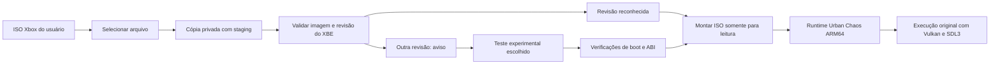

# Launcher baseado na ISO — decisão de produto

Decisão do usuário em 2026-11-17: entregar um launcher Android que seleciona a ISO original, reconhece a revisão e inicia Urban Chaos, com configurações, controles e saves, seguindo a experiência do Black. A ISO e seus recursos permanecem externos ao aplicativo. O runtime já desenvolvido é a base dessa entrega.

No Android, o launcher também é instalado como APK. Seu núcleo executável continua sendo ARM64, com o código Xbox recompilado e os backends gráficos/áudio/input. Selecionar uma ISO não recompila o jogo no tablet. O formato de importação evita empacotar os recursos do disco, mas não elimina a integração Vulkan/SDL3 necessária à execução.

## Rastreio do Black

Revisão `8e9c6fc7d570503ea68d039cff16c09339ee6d30`, igual ao HEAD remoto consultado em 2026-11-17. SDK do Black `99078b119b5d5e0d1d6afb1390e29437c0c984c0`; nosso pin e os contratos adicionais permanecem registrados separadamente.

| Fonte no Black | Comportamento confirmado |
|---|---|
| `README.md`, início e Installation/Building | Declara port nativo ARM64, recompilação estática antecipada, Vulkan/SDL3 e instalação de APK sem assets do jogo |
| `build.bat:67–74` | Executa o recompilador no computador de build e depois Gradle; essa etapa não ocorre quando o usuário seleciona uma ISO no Android |
| `CMakeLists.txt:25–46`, `:94` | Exige `generated/game` e o XBE usado na geração; grava o SHA-1 esperado e compila fontes geradas + runtime + host em `libmain.so` |
| `BlackActivity.java:47–49` | SDLActivity carrega SDL3 e `main`; a Activity não substitui a execução do jogo |
| `GameImporter.java`, `pick()` e `copy()` | SAF seleciona `.iso`; cópia com progresso/cancelamento para `.part`, sincronização e rename antes de disponibilizar a imagem. Não gera código do jogo |
| `native/game_files.cpp`, `Search()` | Procura pasta extraída ou ISO; usa `Disc::Open/Load` para ler `default.xbe`; compara a revisão ao hash embutido no build e monta a imagem |
| `native/game_files.cpp`, `AskOtherRelease()` | Para revisão diferente, avisa que provavelmente falhará e oferece No / Yes / Yes, don't ask again; a escolha persistida não prova compatibilidade |
| `native/game_files.cpp`, `ConvertEurope()` | Conversão específica e conhecida do executável europeu para o esperado. Esse patch e esses endereços não são aplicáveis a Urban Chaos |
| `native/main.cpp:364–373` | Depois de localizar os arquivos, inicializa UI/input e chama `kernel::Boot` com o XBE e diretório de saves |
| `native/touch.cpp`, `src/game/options_menu.cpp`, `src/common/options.*` | HUD/editor, controles e opções são integrados ao host/jogo; a tela Java de importação é apenas uma parte do aplicativo |

Os arquivos acima foram lidos, não executados como Black nesta auditoria. Seu fluxo não demonstra geração dinâmica no tablet nem um launcher capaz de dispensar código de jogo compatível.

## Fluxo definido para Urban Chaos



A construção desse núcleo ocorre uma vez por revisão qualificada na nuvem. No tablet, o fluxo é selecionar/importar, reconhecer, montar e executar. Reabrir o aplicativo reutiliza a instalação selecionada; não exige regenerar os arquivos recompilados a cada início.

- Priorizar ISO/XISO e Redump suportado, montados para leitura dos recursos sob o volume Xbox `D:`. Pasta extraída continua como alternativa, sem exigir extração completa para a rota ISO.
- SAF e cópia privada permitem usar um provedor que ofereça somente streaming: após a cópia, o arquivo local aceita leituras aleatórias. Leitura direta por URI/FD só será anunciada quando o backend e o provedor suportarem seek e persistência de acesso de forma testada.
- Validar estrutura XDVDFS, extents e `default.xbe` antes de ativar a instalação. A cópia incompleta não pode aparecer como jogo instalado. Manter progresso, cancelamento, espaço livre e recuperação após interrupção.
- O reconhecimento usa o hash do **XBE**, não apenas o tamanho ou hash do contêiner ISO. Redump e XISO podem ter contêineres diferentes e o mesmo executável. Completude/integridade dos recursos é uma verificação adicional.
- A referência atual de desenvolvimento é o XBE fornecido `c6f0c99ad57eafa2fc9caedb5ab2a7b192ff5fdde7e5faddc5e62a1730f044d1`, Title ID `534300F7`. A referência histórica Burner `b74a…` não é anunciada como compatível com esse mesmo núcleo sem nova qualificação.
- Outra revisão do mesmo título, estruturalmente válida: aviso de compatibilidade não validada e opção explícita de teste experimental. Esse modo não contorna verificações de entrada, limites de memória ou ABI; não converte um executável desconhecido no código compilado. Não compartilhar saves entre variantes não qualificadas. PS2, outro título e imagem inválida são recusados.
- `game`/ISO, `saves`, `config`, `config/hud`, `cache/shaders` e `logs` continuam separados. Trocar ISO exige encerrar o runtime e suas referências antes de desmontar a instalação anterior.
- Completar HUD, gamepad, opções gráficas, áudio, lifecycle e atualização preservando saves sobre os consumidores reais do Urban Chaos. A política de acesso amplo do Black não é necessária para seleção via SAF.

## Aproveitamento e estado real

Já existem inspetor/importador Xbox, suporte `kernel::Disc`/`MountDisc` no SDK, código guest compilado para ARM64 e runtime Linux que apresentou a abertura de Hope Street e sua pausa. O módulo Android histórico continua diagnóstico; ele não é o launcher final nem comprova que o jogo roda no tablet.

O leitor nativo do pin do SDK procura partições em `0` e `0x18300000`. Layouts adicionais reconhecidos por ferramentas Python não são automaticamente suportados na montagem nativa. Validar as duas camadas antes de declarar suporte a uma imagem.

O reconhecimento e a montagem já estão ligados ao host Linux pelo componente compartilhado `native/game/source.*`. A seleção Android/SAF ainda precisa chamar esse componente. Para obter a experiência completa, faltam integrar Vulkan com reports reais, compatibilizar o callback de áudio SDL3 e validar os controles/saves. [Contratos](RUNTIME_CONTRACTS.md), [Android](ANDROID_PORT.md) e [estado executado](BUILD_STATUS.md). Não foi criado ou compilado outro APK nesta mudança de planejamento.

## Ligação executável da fonte do jogo

`native/game/source.*` abre pasta ou ISO, valida estrutura e digests das seções do XBE, calcula SHA-256 e compara Title ID/entry ao perfil do build. A montagem só ocorre após a aceitação da revisão; uma recusa preserva a montagem anterior. Outra revisão exige escolha explícita e continua experimental. Não há conversão de executáveis nem alteração da imagem.

O patch explícito `bounded-disc-reader.patch` preserva o pin MIT e limita leituras à imagem, tamanho/acúmulo de tabelas, profundidade e quantidade de entradas. Rejeita ciclos, registros sobrepostos, colisões de nomes e nomes que escapariam de diretórios. O arquivo é aberto somente para leitura. A pasta alternativa valida o XBE; a árvore completa continua sob responsabilidade do importador/staging, não desta API.

O host de pesquisa usa esse caminho antes de `kernel::Boot`. Para conferir uma fonte sem executar o jogo:

```sh
build/urban-chaos-user-image/iso-host-v2/cmake/urban_research private/jogo.iso --check-source
```

Remover `--check-source` solicita o boot real. `--allow-other-revision` é opt-in experimental: não ignora Title ID, entry ou integridade estrutural. Não trocar a montagem enquanto existirem threads de uma instalação anterior. O gravador `run_private_research.py` continua aceitando pasta; a CLI nativa aceita ambas as fontes.

Doze testes nativos usam somente arquivos de autoria própria: SHA-256, revisão/cancelamento, PS2/arquivo comprimido, truncamento, diretórios inválidos, leituras simultâneas e EOF. `scripts/build_source_probes.py` os executa; `scripts/build_portability.sh` compila o mesmo leitor/validador para AArch64. Compilação ARM64 não equivale a execução no tablet.

O XBE real também passou na pasta e dentro de um contêiner privado construído apenas para reconhecimento. Esse contêiner contém somente o XBE, não representa a ISO completa e não foi usado para alegar boot por ISO. A execução integral da imagem comercial nesse novo caminho permanece pendente; os recursos reais extraídos continuam disponíveis para regressões do host.
